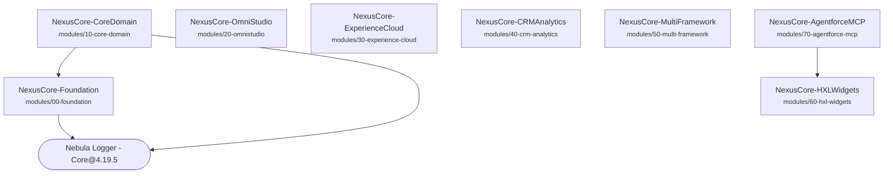

# Module Dependency Graph

> Generated by `npm run audit:deps -- --write docs/architecture/module-dependencies.md`. Do not edit by hand.

Solid arrows are references found in source; every one must also be declared in `sfdx-project.json`.

